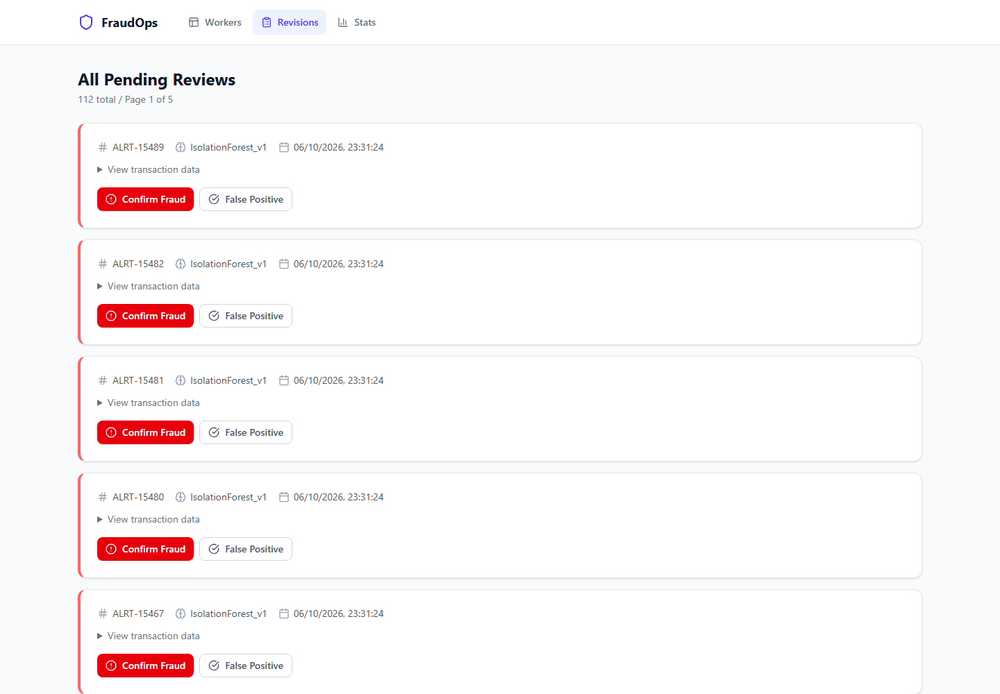
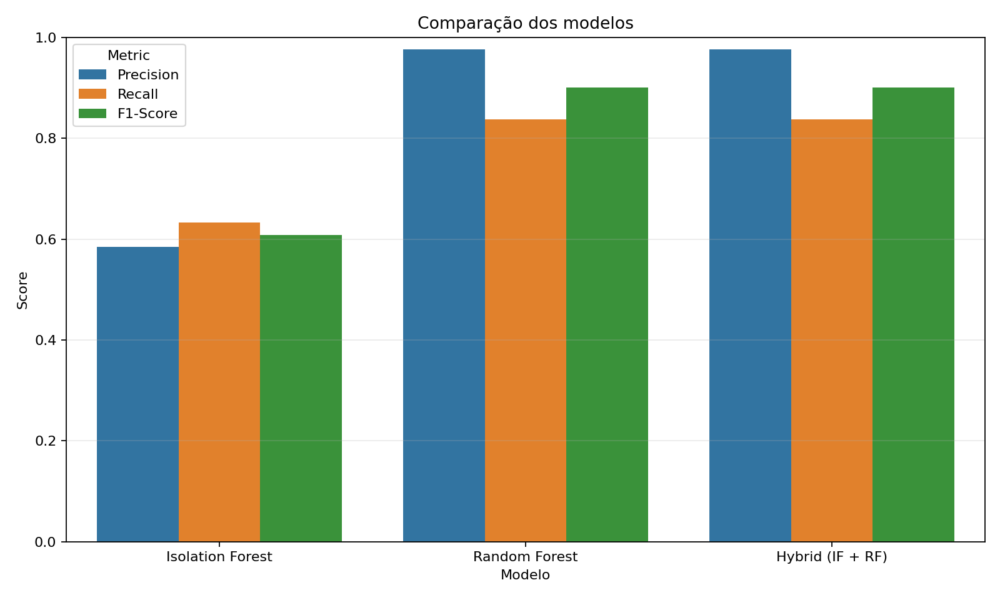
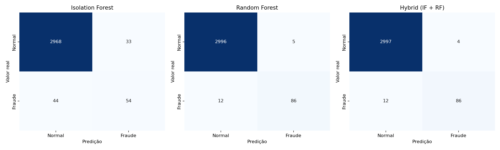

# Hub de detecção de anomalias
Projeto de estudo sobre detecção de anomalias com Machine Learning, streaming e processamento orientado a eventos.



Hub após o seed de demonstração: 112 alertas aguardando revisão humana. A comparação dos modelos aparece na seção de avaliação offline.

## Descrição
Este projeto foi criado para estudar arquitetura de software, machine learning e engenharia de dados. A pipeline captura alterações em uma tabela PostgreSQL, publica eventos no Kafka, aplica modelos de detecção e disponibiliza os alertas em um hub web para revisão humana.
O Compose possui 11 serviços principais e um serviço opcional de seed:
- 2 para a aplicação web (Hub)
- 2 para detecção e tratamento de anomalias
- 2 bancos PostgreSQL (origem e interno)
- 5 para CDC, streaming e observabilidade: Zookeeper, Kafka, Kafka Connect, configuração automática do conector e Kafka UI

## Dataset
- [Credit Card Fraud Detection](https://www.kaggle.com/datasets/mlg-ulb/creditcardfraud) (dataset ativo na demonstração)
  - O dataset original possui 284807 transações e 492 fraudes. A demonstração local usa o arquivo reduzido `creditcard_small.csv`, com 15492 registros, incluindo as 492 fraudes.
  - Fonte: Machine Learning Group da ULB e Worldline. A [página do dataset](https://www.kaggle.com/mlg-ulb/creditcardfraud/data) indica [Open Database License (ODbL) 1.0](https://opendatacommons.org/licenses/odbl/1-0/) para a base e [Database Contents License (DbCL) 1.0](https://opendatacommons.org/licenses/dbcl/1-0/) para seu conteúdo. O arquivo reduzido incluído neste repositório deriva dessa base e mantém essa atribuição.

## Arquitetura do projeto


 - Fonte de dados
    - Um banco de dados de origem (Source DB)
    - O Debezium faz CDC (Change Data Capture) e publica os eventos de mudança no Kafka

  - Plataforma de streaming
    - Kafka é a camada de mensageria
    - Zookeeper gerencia o cluster Kafka
    - Kafka UI é usada para monitorar tópicos e mensagens

  - Serviços de processamento
    - Anomaly Detector consome os eventos do Kafka, aplica o modelo de detecção e identifica anomalias
    - Anomaly Handler também consome do Kafka e faz o tratamento das anomalias geradas
    - O detector publica as anomalias em um tópico Kafka
    - O handler persiste os alertas no banco interno e pode enviar um aviso por email

  - Aplicação web
    - Frontend em React/Vite
    - Backend API em Python
    - Banco de dados interno PostgreSQL para armazenar os resultados e o status das anomalias

## Requisitos

Para a comparação rápida dos modelos, basta Python 3.12+. Para executar a arquitetura completa, use Docker.

### Sistema
- **Python**: versão 3.12+
- **Docker**: versão 20.10+ 
- **Docker Compose**: versão 2.0+
- **RAM**: mínimo 4GB disponível (recomendado 8GB)
- **Espaço em disco**: mínimo 5GB

### Versões dos componentes principais
- Kafka: 7.4.0
- PostgreSQL: 15-alpine
- Zookeeper: 7.4.0 (integrado com Kafka)
- Debezium Connect: 3.2
- Kafka UI: v0.7.2
- Python dependencies: ver `requirements.txt` de cada módulo

**Nota**: O projeto roda totalmente em containers; não é necessário iniciar backend ou frontend localmente quando o Compose é usado.

## Credenciais e Portas Padrão

### Serviços Web
| Serviço | URL | Descrição |
|---------|-----|-----------|
| Frontend | http://localhost:3000 | Aplicação web de detecção de anomalias |
| Backend API | http://localhost:8000 | API FastAPI |
| Kafka UI | http://localhost:8080 | Monitoramento de tópicos Kafka |
| Kafka Connect | http://localhost:8083 | Gerenciamento de conectores Debezium |
| Kafka | localhost:9092 | Broker Kafka |
| Zookeeper | Somente na rede Docker | Orquestrador Kafka |

### Email (Anomaly Handler)
O Compose usa valores de demonstração para os bancos e e-mails fictícios. Não reutilize essas senhas fora do ambiente local. As portas publicadas pelo Compose ficam vinculadas a `127.0.0.1` no computador host.

Para configurar e-mail real, crie um arquivo `.env` local (ignorado pelo Git) com `SENDER_EMAIL`, `EMAIL_PASSWORD` e `RECIEVER_EMAIL`, e defina `EMAIL_ENABLED=true`. O envio fica desabilitado por padrão. `SMTP_TIMEOUT_SECONDS` controla o timeout da conexão, com padrão de 10 segundos. O Compose lê essas variáveis sem precisar editar o arquivo versionado. O envio de e-mail não é necessário para persistir e revisar os alertas.

## Instalação e Execução

O repositório possui duas formas complementares de execução:

- **Comparação rápida:** avalia os modelos e gera gráficos localmente, sem iniciar a infraestrutura.
- **Demonstração completa:** executa CDC, Kafka, Detector, Handler, bancos, API e frontend com Docker Compose.

### Opção 1: comparação rápida dos modelos

Crie um ambiente virtual e instale as dependências a partir da raiz do repositório:

```bash
python -m venv .venv

# Windows PowerShell
.\.venv\Scripts\Activate.ps1

# Linux ou macOS
source .venv/bin/activate

python -m pip install -r requirements.txt
```

Execute o benchmark com o dataset incluído no projeto:

```bash
python scripts/model_testing/model_testing.py
```

O caminho do dataset é resolvido em relação ao próprio repositório, portanto não precisa ser alterado em outro computador. O comando compara Isolation Forest, Random Forest e o modelo híbrido usando conjuntos separados de treino, validação e teste. A validação é usada para escolher os thresholds e o conjunto de teste somente para as métricas finais.

A tabela informa explicitamente `Anomalies Detected`, que representa todos os registros sinalizados pelo modelo (`TP + FP`), e `Frauds Caught`, que representa quantas fraudes reais foram corretamente identificadas (`TP`). Os contadores TP, FP, FN e TN também permanecem disponíveis para interpretar o resultado completo.

#### Resultados reproduzidos no conjunto de teste

Execução com `creditcard_small.csv` (15.492 registros, 492 fraudes), semente 42 e divisão estratificada por grupos de features idênticas em treino (9.295), validação (3.099) e teste (3.098). Os thresholds foram escolhidos na validação; os valores abaixo são do teste separado. Registros com features idênticas permanecem no mesmo conjunto, por isso as proporções 60/20/20 são aproximadas. Nesta execução, o híbrido teve o mesmo resultado do Random Forest, sem ganho adicional no teste.

| Modelo | Precision | Recall | F1-score | Alertas (TP + FP) | Fraudes detectadas (TP) | FP | FN |
|---|---:|---:|---:|---:|---:|---:|---:|
| Isolation Forest | 58,49% | 63,27% | 60,78% | 106 | 62 | 44 | 36 |
| Random Forest | 97,62% | 83,67% | 90,11% | 84 | 82 | 2 | 16 |
| Híbrido (IF + RF) | 97,62% | 83,67% | 90,11% | 84 | 82 | 2 | 16 |





Esses números pertencem ao benchmark offline, não à execução ponta a ponta exibida no Hub. A amostra inclui todas as 492 fraudes do dataset original e, por isso, não representa a prevalência real de fraude. O resultado não estima desempenho em produção.

Os resultados são exibidos no terminal e gravados em `artifacts/model_testing/`:

- `metrics.csv`;
- `metrics_comparison.png`;
- `confusion_matrices.png`;
- `evaluation_config.json`.

Para avaliar outro CSV numérico e binário:

```bash
python scripts/model_testing/model_testing.py --dataset caminho/dataset.csv --target-column Class --ignore-columns Time
```

O arquivo `evaluation_config.json` registra a estratégia de separação, a quantidade de duplicatas, uma impressão digital dos dados avaliados e os thresholds.

Essa comparação é um benchmark offline dos modelos. Ela não executa Kafka, CDC, Detector, Handler ou Hub.

### Configuração do ambiente

O `docker-compose.yml` contém valores de demonstração para os bancos. O `.env.example` documenta somente as variáveis opcionais de e-mail consumidas pelo Compose: `EMAIL_ENABLED`, `SMTP_TIMEOUT_SECONDS`, `SENDER_EMAIL`, `EMAIL_PASSWORD` e `RECIEVER_EMAIL`. O arquivo `.env` é ignorado pelo Git e não deve ser versionado.

### Opção 2: demonstração completa com Docker Compose
```bash
# Depois de clonar o repositório, entre na pasta do projeto
cd database_anomalies

# Primeira execução: iniciar serviços e inserir o dataset de demonstração
docker compose --profile seed up --build -d

# Em outro terminal, para ver logs
docker compose logs -f

# Parar os serviços
docker compose down
```

### Demonstração completa com seed de dados
```bash
# Iniciar todos os serviços e executar o seed automatizado do dataset de cartão
docker compose --profile seed up --build -d
```

### Como verificar se tudo subiu
- Frontend: `http://localhost:3000`
- Backend API: `http://localhost:8000`
- Kafka UI: `http://localhost:8080`
- Kafka Connect: `http://localhost:8083`

### Demonstração com dados

O serviço `seed_transactions` é executado somente com o profile `seed`. Ele insere os registros normais, aguarda o treinamento inicial da pipeline `creditcard_transactions` e depois insere os registros fraudulentos. O fluxo completo pode ser iniciado com um único comando:

```bash
docker compose --profile seed up --build -d
```

Depois, consulte o dashboard em `http://localhost:3000` ou a API em `http://localhost:8000/api/anomalies`.

## Persistência e reprocessamento

PostgreSQL, Kafka e Zookeeper usam volumes nomeados. `docker compose down` preserva esses volumes; `docker compose up -d` retoma o ambiente. O seed preserva uma demonstração já carregada e retoma a segunda fase quando apenas os registros normais já existem. Ele recusa substituir uma tabela com outra quantidade de dados.

Os modelos ficam em `anomaly_detector/src/models`. Se o banco interno for recriado ou os artefatos da versão ativa estiverem ausentes, o detector realiza um novo treinamento inicial e registra uma nova versão; arquivos antigos sozinhos não substituem os metadados do banco. Após um reset, essa versão é treinada com os dados presentes na origem naquele momento.

Os consumidores confirmam offsets depois do processamento. Uma falha de gravação ou publicação interrompe o serviço, e o Compose o reinicia para reprocessar o evento. A persistência de alertas ignora IDs já existentes, preservando revisões humanas. Essa entrega admite repetição; e-mail é uma notificação opcional, com tentativa somente na primeira inserção, e não tem garantia de entrega.

Para recomeçar o experimento, `docker compose down -v` remove os volumes de dados. Os arquivos locais de modelos permanecem; com o banco interno novo, eles serão substituídos por uma versão registrada ao iniciar novamente com o profile `seed`.

## Estrutura do projeto
- anomalies_hub_backend - Backend da aplicação web, feito com python e FastAPI
- anomalies_hub_frontend - Frontend da aplicação. Feito com React + Vite
- anomaly_detector - Analisa os eventos do kafka para detectar anomalias. Python + Scikit-Learn
- anomaly_handler - Trata as anomalias, persistindo-as no banco interno e podendo enviar um aviso por email
- docs - Contém o diagrama da arquitetura e a configuração base para o conector source do kafka
- scripts
  - model_testing - Benchmark offline e geração dos gráficos de comparação dos modelos
  - startup_datasets_seed - Seed automatizado do dataset de cartão usado na demonstração completa

### Compartilhamento entre Backend e Detector

O Detector é o proprietário do treinamento, inferência e versionamento dos modelos. Para evitar duplicar essa lógica, o backend reutiliza diretamente os módulos de treinamento e versionamento localizados em `anomaly_detector/src`.

No `docker-compose.yml`, o serviço `hub-backend` monta `./anomaly_detector/src` em `/app/src` e `./anomaly_detector/src/models` em `/app/models`. Com isso, os endpoints de retreinamento, consulta de versões e troca do modo de inferência chamam a mesma implementação usada pelo Detector e acessam os mesmos artefatos de modelo.

Esse compartilhamento é intencional neste monorepo acadêmico: mantém uma única implementação das regras de Machine Learning, mas significa que o backend não deve ser executado isoladamente sem disponibilizar o código e os modelos do Detector. Uma futura separação em serviços independentes exigiria extrair esse código para um pacote Python compartilhado e versionado.

## Fluxo dos dados
Banco de dados origem (cdc) -> debezium -> Kafka -> anomaly detector -> kafka -> anomaly handler -> Banco de dados interno (Postgres) -> anomalies hub backend -> anomalies hub frontend

## Roteiro de demonstração

1. Execute `docker compose --profile seed up --build -d`.
2. Confirme no Kafka Connect (`http://localhost:8083/connectors/source-postgres/status`) que o conector está em execução.
3. Abra o Kafka UI (`http://localhost:8080`) para observar o tópico `source-postgres.public.creditcard_transactions` e, quando houver alerta, `detected_anomalies`.
4. Abra o Hub (`http://localhost:3000`) e revise os alertas pendentes. Marque um como fraude confirmada ou falso positivo.
5. Após registrar ao menos uma fraude confirmada e um falso positivo, acione o retreinamento pelo Hub ou por `POST /api/pipelines/creditcard_transactions/retrain`. Com poucos exemplos, o Random Forest é treinado sem métricas de validação; essas métricas só são registradas quando treino e teste comportam ambas as classes.
6. Para usar os dois modelos, selecione o modo `hybrid` no Hub depois do retreinamento. A API equivalente é `POST /api/pipelines/creditcard_transactions/inference-mode` com `{ "inference_mode": "hybrid" }`; a pipeline inicia em `if` enquanto não há modelo supervisionado válido. A seleção de `rf` é rejeitada pela API e desabilitada no Hub quando o artefato supervisionado está ausente. Um carregamento malsucedido preserva o último conjunto válido de modelos.

Este é um MVP acadêmico. As credenciais do Compose são locais, os resultados não representam validação para produção e cada alerta deve passar por revisão humana.

## Comandos úteis

### Docker
```bash
# Ver logs de um serviço específico
docker compose logs -f hub-backend
docker compose logs -f worker-worker_transactions

# Listar containers e status
docker compose ps

# Reiniciar um serviço
docker compose restart hub-backend

# Parar todos os serviços e remover volumes (limpeza total)
docker compose down -v

# Rebuildar uma imagem após mudanças
docker compose build hub-backend
```

### Desenvolvimento
```bash
# Subir tudo em foreground (com logs)
docker compose up

# Subir tudo em background
docker compose up -d

# Subir apenas serviços específicos
docker compose up hub-backend hub-frontend

# Rebuildar e subir (após alterações de código)
docker compose up --build
```

## API Reference

A documentação interativa da API (Swagger UI) está disponível em:
- **Swagger UI**: [http://localhost:8000/docs](http://localhost:8000/docs)
- **ReDoc**: [http://localhost:8000/redoc](http://localhost:8000/redoc)

### Endpoints

#### Anomalias

| Método | Path | Descrição |
|--------|------|-----------|
| `GET` | `/api/anomalies` | Lista anomalias paginadas. Query params: `status` (default: `pending_revision`), `limit` (1 a 100), `offset` (>= 0), `origin_table` |
| `PUT` | `/api/anomalies/{alert_id}/status` | Atualiza o status de um alerta. Body: `{ "status": "confirmed_fraud" \| "false_positive" \| "pending_revision" }` |
| `GET` | `/api/anomalies/stats` | Retorna contagens por status, gráfico dos últimos 7 dias e precision baseada nos alertas revisados |
| `GET` | `/api/anomalies/stats/by-table` | Retorna contagens agrupadas por tabela e precision baseada nos alertas revisados |

#### Pipelines

| Método | Path | Descrição |
|--------|------|-----------|
| `GET` | `/api/pipelines` | Lista todas as pipelines de ML configuradas, com contagem de pendentes |
| `POST` | `/api/pipelines/{target_table}/retrain` | Executa o retreinamento dos modelos para a tabela alvo |
| `POST` | `/api/pipelines/{target_table}/inference-mode` | Atualiza o modo de inferência (`if`, `rf` ou `hybrid`) |

### Métricas exibidas no dashboard

O dashboard exibe:

- total de alertas;
- alertas pendentes;
- fraudes confirmadas;
- falsos positivos;
- histórico diário de fraudes confirmadas e falsos positivos;
- precision global e por tabela.

Os números de fraudes confirmadas e falsos positivos vêm do status atribuído durante a revisão dos alertas. A precision exibida é calculada assim:

`fraudes confirmadas / (fraudes confirmadas + falsos positivos)`

Essa é uma métrica operacional da revisão dos alertas, não uma avaliação completa do modelo. O benchmark offline calcula precision, recall, F1-score e matrizes de confusão em um conjunto de teste rotulado e separado. Esses resultados continuam sendo experimentais e não representam desempenho em produção.

## Testes automatizados

Instale as dependências do projeto e de teste e execute a suíte a partir da raiz:

```bash
python -m pip install -r requirements.txt -r anomalies_hub_backend/requirements.txt pytest
pytest -q
```

## Troubleshooting

### Porta 3000 já está em uso
```bash
# Linux/macOS
lsof -i :3000

# Windows
netstat -ano | findstr :3000
```
Encerre o processo que está usando a porta ou altere a porta no `docker-compose.yml`.

### Modelo não treina
- Verifique permissões da pasta `anomaly_detector/src/models` — precisa ser gravável
- Confira se os dados de seed estão disponíveis: `docker compose --profile seed logs seed_transactions`
- Se a tabela não existir no source-DB, a pipeline não encontrará dados para treinar

### Kafka não conecta
```bash
# Verificar logs do Kafka
docker compose logs kafka

# Verificar se o Zookeeper está saudável
docker compose logs zookeeper
```
Aguarde ~30 segundos após `docker compose up` para o Kafka inicializar completamente.

### Erro de conexão no backend
- Confirme que o banco interno está rodando: `docker compose logs postgres-internal`
- Verifique as variáveis de ambiente no `docker-compose.yml` (seção `hub-backend`)
- O backend depende do `postgres-internal` — certifique-se de que ele está healthy

## Melhorias e sugestões
- [x] Cobertura inicial de testes (pytest)
- [ ] CI/CD com GitHub Actions
- [ ] Logs estruturados em JSON
- [x] Health checks de PostgreSQL e Kafka; serviços dependentes aguardam prontidão
- [ ] Ampliar health checks para os demais serviços
- [ ] Otimização multi-stage dos Dockerfiles

Sugestões são bem-vindas! Abra uma issue ou envie um PR.
